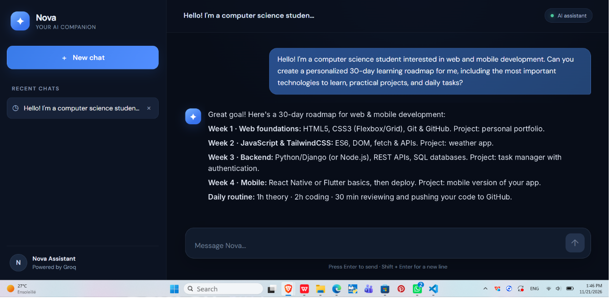
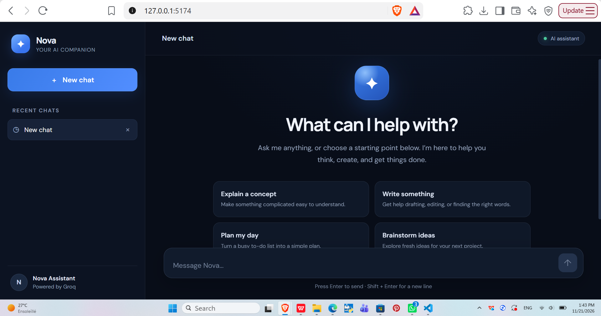

# Nova – AI Chatbot

An AI-powered conversational web application built with React and Vite, featuring a modern and responsive interface.

🌐 **Live Demo:** https://afafak.github.io/work-simple/

## 📸 Screenshots

### Chatbot Interface


### Chatbot Conversation


## ✨ Features

- Modern and responsive chat interface
- AI-powered conversations using Groq API
- Conversation history
- Interactive messaging
- Markdown response rendering
- Clean and intuitive user experience

## 🛠️ Technologies

- React
- Vite
- JavaScript
- CSS
- Groq API
- Llama 3.3 70B

## ⚙️ Installation

Clone the repository:

```bash
git clone https://github.com/AfafAK/work-simple.git
cd work-simple
```

Install dependencies:

```bash
npm install
```

Create a `.env.local` file and configure your Groq API key:

```env
VITE_GROQ_API_KEY=your_api_key
```

Start the development server:

```bash
npm run dev
```

## 🏗️ Production Build

```bash
npm run build
```

## 👩‍💻 Author

**Afaf Ait Khouya**

GitHub: [@AfafAK](https://github.com/AfafAK)

---

*Developed as a personal project to explore modern frontend development and AI-powered applications.*